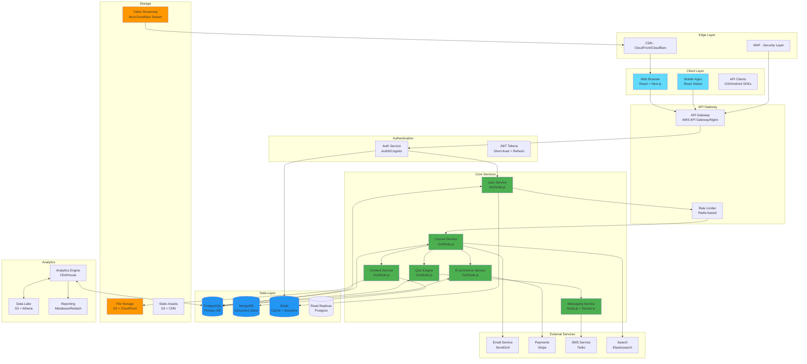
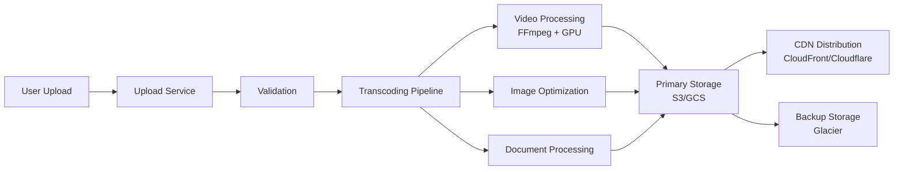
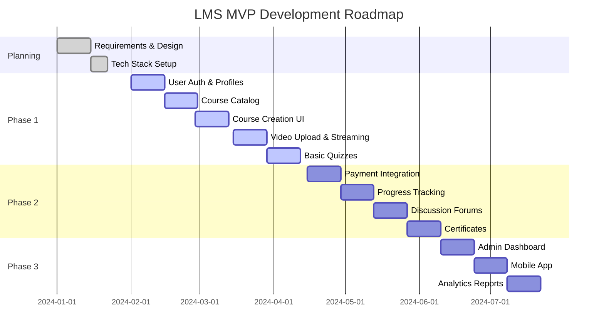

# Learning Management System (LMS) - Architecture Design

## Requirements

### Functional
- **User Roles**: Student, Instructor, Admin, Parent/Guardian
- **Course Management**: Create, publish, archive courses and lessons
- **Content Delivery**: Videos, PDFs, images, quizzes, assignments
- **Learning Pathways**: Prerequisites, progress tracking, completion certificates
- **Assessments**: Multiple choice, essays, auto-graded quizzes
- **Communication**: Discussion forums, messaging, announcements
- **Analytics**: Student progress, course completion, revenue reports
- **E-commerce**: Course purchases, subscriptions, coupons
- **Mobile Experience**: Responsive web, native mobile apps

### Non-Functional
- **Performance**: API response < 100ms p95, video streaming optimized
- **Availability**: 99.95% uptime SLA (4.38 hours downtime/year)
- **Scalability**: Support 50,000 concurrent users, 1M+ active learners
- **Security**: SOC 2 compliance, GDPR compliant, encrypted PII/PII data
- **Reliability**: Multi-region deployment, automatic failover

### Constraints
- Budget: $2,000-$5,000/month for infrastructure (MVP scale)
- Timeline: MVP in 4 months, Full release in 8 months
- Team: 3 frontend, 4 backend, 2 DevOps, 1 QA

---

## High-Level Architecture



---

## Component Details

### Backend Microservices (Go + gRPC)

| Service | Language | Database | Description |
|---------|----------|----------|-------------|
| **User Service** | Go | PostgreSQL | Authentication, profiles, roles |
| **Course Service** | Go | PostgreSQL | Course catalog, enrollments, progress |
| **Content Service** | Go | MongoDB/S3 | File management, metadata |
| **Quiz Engine** | Go | PostgreSQL | Quizzes, assignments, grading |
| **E-commerce** | Go | PostgreSQL | Payments, subscriptions, coupons |
| **Messaging** | Node.js | Redis | Real-time chat, notifications |

### Database Strategy

```yaml
Primary Database: PostgreSQL
  - ACID transactions required for enrollments, payments
  - Complex queries for analytics (JSONB for flexible data)
  - Extensions: TimescaleDB for time-series analytics
  - Connection pooling: PgBouncer

Document Store: MongoDB
  - Course content catalogs
  - User activity logs
  - Flexible schema for varied content types

Cache: Redis
  - Session storage
  - Rate limiting counters
  - Leaderboard caches
  - Media metadata

Analytics: ClickHouse
  - Event analytics
  - Real-time dashboards
  - Course usage patterns
```

### Storage Architecture



---

## Technology Stack

### Frontend

| Layer | Technology | Rationale |
|-------|------------|-----------|
| **Framework** | React 18 + Next.js 14 App Router | SSR for SEO, SSG for content, RSC for performance |
| **State Management** | Zustand + React Query | Lightweight, SSR-compatible, caching |
| **UI Library** | Shadcn/ui + TailwindCSS | Accessible, customizable, design-system ready |
| **Forms** | React Hook Form + Zod | Type-safe, performant validation |
| **Rich Text** | Slate.js/Tiptap | Extensible editor for course content |
| **Video Player** | Video.js + HLS.js | Adaptive streaming, accessibility |

### Backend

| Layer | Technology | Rationale |
|-------|------------|-----------|
| **Language** | Go 1.22 | Performance, concurrency, simplicity |
| **Web Framework** | Fiber/Chi | Fast HTTP routing |
| **API Style** | gRPC + REST gateway | Efficient internal comms, external compatibility |
| **Message Queue** | RabbitMQ/NATS | Reliable async processing |
| **Background Jobs** | Temporal.io | Distributed workflow orchestration |

### Infrastructure

| Component | Service | Rationale |
|-----------|---------|-----------|
| **Hosting** | AWS ECS/Fargate | Managed containers, serverless scaling |
| **Load Balancing** | Application Load Balancer | TCP/HTTP routing |
| **Database** | Amazon RDS PostgreSQL | Managed, backups, monitoring |
| **Storage** | S3 + CloudFront | Global CDN, versioning |
| **Video** | Mux or Cloudflare Stream | Adaptive streaming, analytics |
| **Monitoring** | Datadog/Prometheus | Observability stack |
| **Logging** | ELK Stack (Elastic Cloud) | Structured log aggregation |
| **CI/CD** | GitHub Actions + ArgoCD | GitOps, automated deployments |

### Development Tools

| Category | Tools | Ecosystem |
|----------|-------|-----------|
| **IDE** | VS Code | Extensions: Go, React, Docker |
| **Containerization** | Docker + BuildKit | Multi-stage builds |
| **Testing** | GoGab, Jest, Cypress | Unit, integration, E2E |
| **API Docs** | OpenAPI 3.1 + Redocly | Auto-generated docs |
| **Type Safety** | TypeScript | Full-stack type checking |
| **Code Quality** | golangci-lint, ESLint, Prettier | Consistent code style |

---

## Microservice Boundaries

### Bounded Contexts

```
┌─────────────────────────────────────────────────────────────┐
│                    USER MANAGEMENT                           │
├─────────────────────────────────────────────────────────────┤
│ Authentication (OAuth2, SSO)                               │
│ User profiles and preferences                              │
│ Role management (Student, Instructor, Admin)               │
│ Subscription tiers                                         │
└─────────────────────────────────────────────────────────────┘

┌─────────────────────────────────────────────────────────────┐
│                    COURSE DOMAIN                             │
├─────────────────────────────────────────────────────────────┤
│ Course catalog                                             │
│ Learning paths & prerequisites                             │
│ Modules, lessons, sections                                 │
│ Student enrollments                                        │
│ Progress tracking                                          │
│ Certificates                                               │
└─────────────────────────────────────────────────────────────┘

┌─────────────────────────────────────────────────────────────┐
│                    CONTENT MANAGEMENT                        │
├─────────────────────────────────────────────────────────────┤
│ Media uploads                                              │
│ Video processing pipeline                                  │
│ Content metadata                                           │
│ DRM & access control                                       │
│ Offline content                                            │
└─────────────────────────────────────────────────────────────┘

┌─────────────────────────────────────────────────────────────┐
│                    ASSESSMENT DOMAIN                       │
├─────────────────────────────────────────────────────────────┤
│ Quiz creation                                              │
│ Auto-grading engine                                        │
│ Assignment submission                                      │
│ Gradebook                                                  │
│ Peer review                                                │
└─────────────────────────────────────────────────────────────┘

┌─────────────────────────────────────────────────────────────┐
│                    E-COMMERCE DOMAIN                         │
├─────────────────────────────────────────────────────────────┤
│ Course purchases                                           │
│ Subscriptions                                            │
│ Coupon codes                                               │
│ Refunds                                                    │
│ Revenue reporting                                          │
└─────────────────────────────────────────────────────────────┘
```

---

## Key Decisions (ADRs)

### ADR-001: Microservice Architecture vs Monolith

**Status**: Accepted

**Context**: The LMS requires distinct domains (users, courses, payments) that evolve independently with different scaling needs.

**Decision**: Use microservice architecture with Go services.

**Alternatives Considered**:
- **Monolith** — Faster initial development, but poor scaling boundaries
- **Serverless Functions** — Cost-effective for sporadic traffic, but cold starts affect UX

**Consequences**:
- ✅ Independent scaling per domain
- ✅ Technology flexibility per service
- ✅ Team autonomy
- ❌ Increased operational complexity

### ADR-002: Go vs Node.js for Backend Services

**Status**: Accepted

**Context**: Need high-performance backend capable of handling video processing, real-time messaging, and complex queries.

**Decision**: Use Go as primary backend language.

**Alternatives Considered**:
- **Node.js** — Good ecosystem but limited by single-threaded model
- **Python** — Slower performance, better for ML features
- **Rust** — Higher learning curve, smaller ecosystem

**Consequences**:
- ✅ Better CPU utilization for concurrent requests
- ✅ Lower memory footprint
- ✅ Strong type system reduces bugs
- ❌ Smaller JavaScript/TypeScript ecosystem for frontend-like features

### ADR-003: PostgreSQL as Primary Database

**Status**: Accepted

**Context**: Need ACID transactions for payments, enrollments, and complex relational queries with joins.

**Decision**: Use PostgreSQL with JSONB for flexibility.

**Alternatives Considered**:
- **MongoDB** — Good for content, but no transactions across documents
- **DynamoDB** — Excellent scaling, but poor for ad-hoc queries

**Consequences**:
- ✅ Strong consistency for financial data
- ✅ Complex query support for analytics
- ✅ JSONB provides document-like flexibility
- ❌ Vertical scaling limits at massive scale

### ADR-004: React + Next.js vs Vue + Nuxt

**Status**: Accepted

**Context**: Require SSR for SEO (course catalog), static generation for content, and edge functions.

**Decision**: Use React with Next.js App Router.

**Alternatives Considered**:
- **Vue 3 + Nuxt 3** — Similar features, but smaller ecosystem
- **SvelteKit** — Emerging, smaller community

**Consequences**:
- ✅ Mature ecosystem with extensive libraries
- ✅ Strong TypeScript support
- ✅ Large talent pool
- ❌ Bundle size can be larger

---

## Development Roadmap

### Phase 1: MVP (Months 1-4)



#### MVP Features
- [ ] User registration & authentication (OAuth2 + email/password)
- [ ] Course catalog (search, filter, pagination)
- [ ] Course creation (instructors)
- [ ] Video lessons with progress tracking
- [ ] Multiple choice quizzes
- [ ] Basic leaderboard
- [ ] Stripe payment integration
- [ ] Responsive web UI
- [ ] Admin dashboard

### Phase 2: Enhanced Features (Months 5-8)

- [ ] Assignment submissions (file upload)
- [ ] Discussion forums per course
- [ ] Peer review system
- [ ] Certificates with verification
- [ ] Subscription plans
- [ ] Mobile apps (iOS/Android)
- [ ] Email notifications
- [ ] Analytics dashboards
- [ ] SEO optimization

### Phase 3: Scale & Enterprise (Months 9-12)

- [ ] Multi-tenancy for organizations
- [ ] LMS integrations (SCORM, xAPI)
- [ ] AI-powered recommendations
- [ ] Advanced analytics (ML insights)
- [ ] Offline mode/sync
- [ ] White-label customization
- [ ] Enterprise SSO (SAML, OIDC)

---

## Security Considerations

```yaml
Authentication:
  - OAuth 2.0 + PKCE for mobile
  - SSO support (Azure AD, Google Workspace)
  - MFA mandatory for instructors/admins
  - Passwordless email login option

Authorization:
  - RBAC (Role-Based Access Control)
  - Resource-based permissions
  - Instructor can only view their courses
  - Student can only access enrolled courses

Data Protection:
  - AES-256 encryption at rest
  - TLS 1.3 for all transit
  - PII data tokenization
  - GDPR compliance (data export/deletion)

Content Protection:
  - Signed URLs for private content
  - Domain restrictions for videos
  - Watermarking to prevent piracy
  - View limits per user

Monitoring:
  - Audit logs for all actions
  - Anomaly detection
  - Breach notification system
```

---

## Cost Estimation (AWS)

```yaml
# MVP Scale (1000 concurrent users)
Monthly Estimate:
  ECS/EKS: $800          # 10 t3.medium instances
  RDS PostgreSQL: $300   # db.t3.large multi-AZ
  S3 Storage: $100       # 5TB content storage
  CloudFront: $200       # 10TB data transfer
  Mux Video: $500        # Video streaming
  Redis (ElastiCache): $150 # cache.t3.micro
  Load Balancer: $50     # Application LB
  Monitoring: $100       # Datadog
  TOTAL: $2,200/month

# Production Scale (50,000 concurrent users)
Monthly Estimate:
  ECS/EKS: $4,500        # Auto-scaling fleet
  RDS PostgreSQL: $1,200 # db.r5.xlarge + read replicas
  S3 Storage: $500       # 50TB+ storage
  CloudFront: $2,000     # 100TB+ transfer
  Mux Video: $3,000      # High-volume streaming
  Redis: $800            # cache.r5.large cluster
  ALB: $300              # Multiple load balancers
  Monitoring: $500       # Premium Datadog
  TOTAL: $12,800/month
```

---

## Deployment Architecture

```mermaid
graph TB
    subgraph "Region 1 (Primary)"
        ALB[Application Load Balancer]
        ECS[ECS Service<br/>Multiple AZs]
        RDS[PostgreSQL<br/>Multi-AZ]
        REDIS[Redis Cluster<br/>Multi-AZ]
        S3_BUCKET[S3 Bucket<br/>Versioned]
    end

    subgraph "Region 2 (DR)"
        DR_ECS[ECS Service<br/>Standby]
        DR_RDS[RDS Read Replica<br/>Promotable]
    end

    subgraph "Edge"
        CLOUDFRONT[CloudFront CDN]
        WAF[WAF (Region 1)]
        WAF2[WAF (Region 2)]
    end

    USER[User] --> CLOUDFRONT
    CLOUDFRONT --> WAF
    WAF --> ALB
    ALB --> ECS
    ECS --> RDS
    ECS --> REDIS
    ECS <--> S3_BUCKET
    
    RDS --> DR_RDS
    
    style RDS fill:#ff9999
    style DR_RDS fill:#ffcccc
```

---

## Key Metrics & SLIs

| Metric | SLI | Target | Alert Threshold |
|--------|-----|--------|-----------------|
| API Response Time | p95 | < 100ms | > 200ms |
| Database Latency | avg | < 10ms | > 50ms |
| Video Availability | uptime | 99.9% | < 99.5% |
| Payment Success Rate | success | 99.5% | < 99% |
| User Login Success | success | 99.9% | < 99.5% |
| Error Rate (5xx) | rate | < 0.1% | > 0.5% |
| Cache Hit Rate | ratio | > 95% | < 90% |

---

## Risk Assessment & Mitigation

| Risk | Impact | Likelihood | Mitigation |
|------|--------|------------|------------|
| Video piracy | High | Medium | DRM, watermarking, signed URLs |
| DDoS attacks | High | Medium | AWS Shield, WAF, rate limiting |
| Data breach | Critical | Low | Encryption, access controls, audits |
| Payment fraud | High | Medium | Stripe Radar, 3D Secure |
| Scalability limits | Medium | High | Auto-scaling, caching, read replicas |
| Third-party outages | Medium | Medium | Multi-provider strategy |

---

## Next Steps

1. **Create technical specifications** for each microservice
2. **Set up development environment** (Docker Compose for local dev)
3. **Implement authentication service** as foundation
4. **Build CI/CD pipelines** for GitOps deployment
5. **Create API contracts** (OpenAPI specs)
6. **Set up monitoring & alerting** from day one
7. **Implement security scanning** in pipeline

---

## Additional Resources

- [LMS Research Paper: Learning Analytics](https://example.com/lms-research)
- [SCORM Standards](https://adlnet.gov/scorm)
- [WCAG 2.1 Accessibility Guidelines](https://www.w3.org/WAI/standards-guidelines/wcag/)
- [OWASP Security Best Practices](https://owasp.org/www-project-top-ten/)

---

*Architecture Version*: 1.0
*Date*: 2024
*Author*: Principal Architect